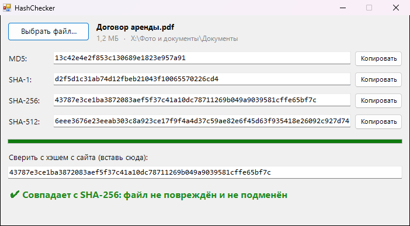

<div align="center">

# 🛡️ HashChecker

**Проверка контрольных сумм файлов: MD5, SHA-1, SHA-256 и SHA-512 за один проход**




</div>

## ✨ Возможности

- 🧮 Считает сразу четыре хэша за одно чтение файла, даже для образов на десятки гигабайт
- 🖱️ Перетащи файл в окно или выбери через диалог
- ✅ Вставь хэш с сайта, и программа сама найдёт, с каким алгоритмом он совпадает (регистр и пробелы не важны)
- 📋 Кнопка «Копировать» у каждого хэша
- ⌨️ Можно из командной строки: `HashChecker.exe файл.iso <ожидаемый-хэш>`

## 💡 Когда пригодится

- Скачал образ Windows или Linux и хочешь убедиться, что он не битый
- Проверяешь, что программу не подменили по пути
- Сравниваешь два файла, не открывая их

## 📥 Установка

1. Скачай `HashChecker.exe` из раздела [**Releases**](../../releases/latest)
2. Запусти его, установка не нужна

## 🛠️ Сборка из исходников

Нужен только Windows: компилятор C# входит в состав .NET Framework.

```bat
build.bat
```

## 📄 Лицензия

[MIT](LICENSE)
